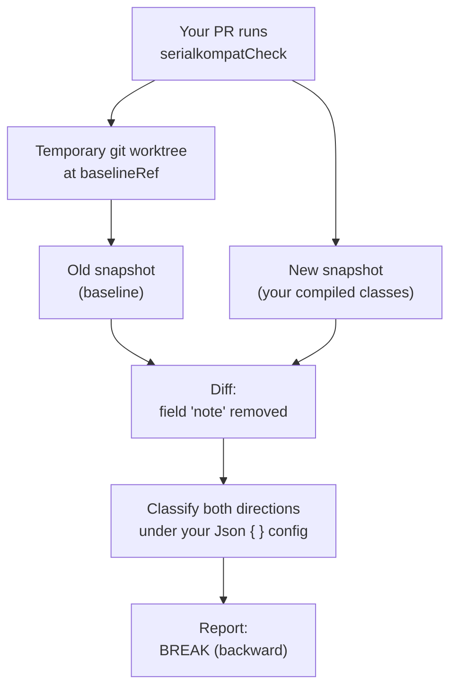

# Architecture

This page follows one real run of `serialkompatCheck` from start to finish, so you can see
what serialkompat actually does and why you can trust its verdict. It's for anyone who
has seen a `BREAK` and wants to know where it came from. Contributors will find the
component map in [Under the hood](#under-the-hood) at the end.

The example is the one on the [home page](index.md): a PR drops the optional `note` field
from `Order`.

```diff
 @Serializable
 data class Order(
     val id: String,
     val amountCents: Long,
-    val note: String? = null,
 )
```

## One run, step by step { #one-run }



### Build both schemas { #build-both-schemas }

<div class="sk-steps" markdown>
<div class="sk-step" markdown>
<span class="sk-step-n">1</span>
**Your PR runs `serialkompatCheck`.** Locally, or in CI through `check` or the GitHub Action.
</div>
<div class="sk-step" markdown>
<span class="sk-step-n">2</span>
**It builds the old schema.** It checks out `baselineRef` (your target branch) in a temporary git worktree and runs the extractor there.
</div>
<div class="sk-step" markdown>
<span class="sk-step-n">3</span>
**It builds the new schema** by running the extractor on your PR's compiled classes, in place.
</div>
</div>

There's no baseline file to commit or forget to update: the old schema always comes from
the code that's on the target branch right now. How the worktree is created, cached and
cleaned up is in [Baseline & caching](baseline-caching.md).

### Extract reads the serializer's own descriptor { #extraction }

serialkompat doesn't parse your source. The extractor runs in a separate JVM on your
project's own runtime classpath, ahead of its own dependencies, loads your compiled `@Serializable` classes, and reads the
`SerialDescriptor` that kotlinx-serialization itself uses to encode and decode them,
against the kotlinx-serialization version your project actually uses. Which classes count
as roots (an explicit `types` list, or a scan of your class directories) is covered in
[Adopting gradually](adopting.md).

From the roots it walks the descriptor graph breadth-first; a visited set handles cycles
and shared types. For each field it records:

- the **wire key**: the key on the wire after `@SerialName` and any `namingStrategy`, not
  the Kotlin property name;
- whether it's **optional** (has a default) and whether it's **nullable**;
- its **type**. A value class is recorded as its underlying type, including that value's
  nullability: `@JvmInline value class Id(val raw: String?)` is `kotlin.String?`, so
  narrowing it to `String` is caught;
- for optional fields, the **`@EncodeDefault` mode**. It isn't visible on the descriptor,
  so the extractor reads it from the class's bytecode. If it can't (for example, behind a
  hand-written serializer), it records the mode as unknown and never assumes it's absent.

Enum values, sealed subtypes and open polymorphism resolved through your
`SerializersModule` go into the same snapshot. A subtype's `@SerialName` only has to be
unique within its base, so subtypes are identified by base and name and reported as
`Base/sub` (for example `OrderEvent/created`). A subtype of two bases is recorded once
per base. In `renames`, `acceptedBreaks`, `include`
and `exclude` you can write `Base/sub` for one base or the bare `sub` for all of them (see
[Configuration](configuration.md)).

It also records the wire config of the `Json { }` (or `Cbor { }`) instance you point it at
with `jsonInstance` (or `cborInstance`): `ignoreUnknownKeys`, `explicitNulls`,
`encodeDefaults` and the rest. With nothing set, that's the default `Json`.

### The two snapshots { #the-snapshots }

The result is a plain-text snapshot, the same thing `serialkompatExtract` writes to
`build/serialkompat/current.snapshot`. This is real extractor output for `Order` before
and after the PR, with the `@config` block cut down to three of its lines:

=== "Before (baseline)"

    ```text
    @contract com.example.Order kind=CLASS
      amountCents: kotlin.Long
      id: kotlin.String
      note: kotlin.String optional nullable encodeDefault=ABSENT

    @config
      encodeDefaults=false
      explicitNulls=true
      ignoreUnknownKeys=false
    ```

=== "After (your PR)"

    ```text
    @contract com.example.Order kind=CLASS
      amountCents: kotlin.Long
      id: kotlin.String

    @config
      encodeDefaults=false
      explicitNulls=true
      ignoreUnknownKeys=false
    ```

`note: kotlin.String optional nullable` says everything the classifier needs: the wire key
is `note`, it has a default, and it can be `null`. `encodeDefault=ABSENT` means there's no
`@EncodeDefault` on it.

### The diff { #the-diff }

The differ compares the two snapshots [contract](concepts.md#glossary) by contract and lists structural changes.
Here there is exactly one: **field `note` removed from `com.example.Order`**. The differ
doesn't judge anything; it only says what changed.

### The verdict, both ways { #the-verdict }

The classifier scores that one change in each direction, using the config recorded in the
snapshots. Compatibility runs two ways:
[backward (new code reads old data)](concepts.md#backward-vs-forward) and
[forward (old code reads new data)](concepts.md#backward-vs-forward).

!!! failure "Backward: new code reads old data. BREAK"
    Payloads written before the PR are still out there, in queues, caches and databases,
    and they still carry `note`:

    ```json
    {"id":"A1","amountCents":1299,"note":"leave at door"}
    ```

    The new `Order` has no `note`, and the new reader uses the default
    `ignoreUnknownKeys = false`, so kotlinx-serialization throws
    `JsonDecodingException: Encountered an unknown key 'note'`. New code can't read old
    data, which makes removing `note` a backward `BREAK`.

!!! success "Forward: old code reads new data. SAFE"
    New code writes payloads without `note`:

    ```json
    {"id":"A1","amountCents":1299}
    ```

    In the old `Order`, `note` was optional (`= null`), so old code fills in the default
    and decodes the payload cleanly. Forward is `SAFE`.

A `SAFE` direction isn't reported, so the report has one line: the backward `BREAK`,
with a fix.

<div class="sk-terminal">
<div class="sk-terminal-bar"><i></i><i></i><i></i><b>CI</b></div>
<pre><code><span class="sk-t-prompt">$</span> ./gradlew serialkompatCheck

serialkompat: 1 active finding(s) (1 breaking, 0 warning), 0 acknowledged

  <span class="sk-t-break">BREAK</span>  PROPERTY_REMOVED  com.example.Order  (backward)
    field 'note' was removed from com.example.Order
    <span class="sk-t-dim">fix: Removing a field drops its data for tolerant readers; keep it (or bridge a rename with @JsonNames) until nothing uses it; else bump major.</span>

<span class="sk-t-fail">BUILD FAILED</span></code></pre>
</div>

**The verdict depends on your config.** The backward reader is the new code, so what
counts is the new side's `ignoreUnknownKeys`. Run the same PR with
`Json { ignoreUnknownKeys = true }` and the old payload decodes without an error, but
`"leave at door"` is silently thrown away. Nothing fails, yet data is lost, so
serialkompat reports it as a `WARN` instead of passing it:

<div class="sk-terminal">
<div class="sk-terminal-bar"><i></i><i></i><i></i><b>CI</b></div>
<pre><code>serialkompat: 1 active finding(s) (0 breaking, 1 warning), 0 acknowledged

  <b>WARN</b>  PROPERTY_REMOVED  com.example.Order  (backward)
    field 'note' was removed from com.example.Order
    <span class="sk-t-dim">fix: Removing a field drops its data for tolerant readers; keep it (or bridge a rename with @JsonNames) until nothing uses it; else bump major.</span></code></pre>
</div>

Every setting that flips a verdict like this is listed in
[Rules → Config awareness](rules.md#config-awareness), and this rule's full entry is
[`PROPERTY_REMOVED`](rules.md#property_removed).

### Why you can trust the verdict { #why-trust }

None of these verdicts come from reading kotlinx-serialization's source or spec. Each
rule is backed by a round-trip oracle test: it encodes a payload with the old model,
decodes it with the new one (and the reverse) using the real library under the declared
config, and checks that every real failure was predicted as a `BREAK`. For
`PROPERTY_REMOVED` that's the `removing an optional field` test in
[`RoundTripOracleTest.kt`](https://github.com/chrisjenx/serialkompat/blob/main/serialkompat-extractor/src/test/kotlin/com/chrisjenx/serialkompat/extractor/RoundTripOracleTest.kt).
A second test there, `a field rename silently loses data under a lenient reader`, proves
the `ignoreUnknownKeys = true` case really drops data and is flagged as a `WARN`. See [The oracle](oracle.md) for how this works and what it covers.

## Under the hood { #under-the-hood }

For contributors, the run above maps onto five components:

<div class="sk-pipeline" markdown>
<div class="sk-stage" markdown>`@Serializable`</div>
<div class="sk-connector"></div>
<div class="sk-stage" markdown>Extractor</div>
<div class="sk-connector"></div>
<div class="sk-stage" markdown>Snapshot</div>
<div class="sk-connector"></div>
<div class="sk-stage" markdown>Differ</div>
<div class="sk-connector"></div>
<div class="sk-stage" markdown>Classifier</div>
<div class="sk-connector"></div>
<div class="sk-stage" markdown>Report</div>
</div>

- **Extractor** (`serialkompat-extractor`): walks the runtime `SerialDescriptor` graph on
  the JVM ([extract](#extraction)) and produces the [snapshots](#the-snapshots). It's the only stage that touches a descriptor or the JVM.
- **Snapshot**: a canonical, comparable model of the wire schema plus its config. From
  here on everything is plain data.
- **Differ**: lists the structural changes between two snapshots ([the diff](#the-diff)).
- **Classifier**: applies the [rules](rules.md) and the recorded config to turn each
  change into a finding with a severity per direction ([the verdict](#the-verdict)).
- **Report**: the findings plus an exit code, printed to the console and also available as
  [JSON, SARIF and GitHub annotations](report-formats.md). The gate runs once and produces a
  single `Report`; each format is a pure function of it in `serialkompat-core` (no I/O, no
  kotlinx-serialization runtime), a read-only view of the same findings, so the format never
  changes the gate's result.

The differ and classifier live in `serialkompat-core`, which is plain Kotlin with **no I/O
and no kotlinx-serialization runtime dependency**. It never touches a file, a git repo or
a live descriptor. That has two payoffs: the Gradle plugin and the
[CLI](tasks-cli.md#cli) share one engine, so rule logic is never duplicated, and the
rules can be unit-tested against plain data.

Some types can't be fully analysed. The extractor never throws on them and never treats
them as safe; see [Limitations](limitations.md#when-a-type-cant-be-analysed).

## Further reading { #further-reading }

The full engineering spec lives in the repo at
[`docs/design`](https://github.com/chrisjenx/serialkompat/tree/main/docs/design). It
covers the design rationale, the complete data model, and the reasoning behind each
guarantee.

## Next { #next }

- [The oracle](oracle.md): how each rule is proven against the real library.
- [Baseline & caching](baseline-caching.md): the git-ref worktree and the caches.
- [Rules](rules.md): the full rule matrix.
