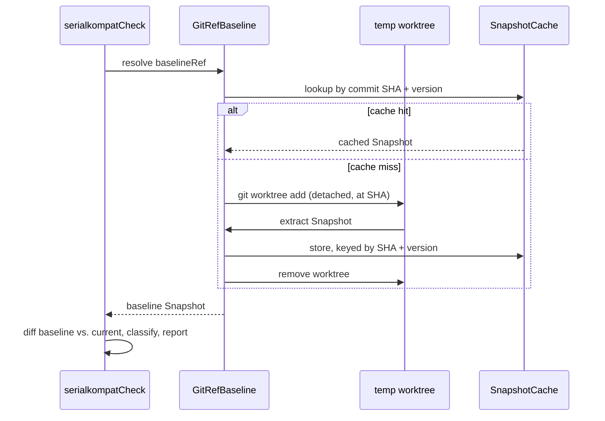

# Baseline & caching

How serialkompat rebuilds the old schema from a git ref on every run, how that work is
cached, and how it behaves under Gradle's build cache, configuration cache and
`--parallel`. Read it if you're tuning CI time or debugging a baseline. What a baseline
*is* is covered in [Concepts](concepts.md#the-baseline).

## The git-ref baseline { #the-git-ref-baseline }

The baseline isn't a file you commit and then forget to update. You name a git ref with
`baselineRef` (or let the plugin detect your default branch), and `GitRefBaseline`
rebuilds the baseline from that ref's source on demand.

It resolves the ref to a commit SHA and checks that exact commit out into a temporary,
detached git worktree under `build/serialkompat/worktrees/`. Inside it, it runs a nested
Gradle build of that module's `serialkompatExtract` task. So every run compares against
what's *actually* on that ref right now, extracted with that ref's own configuration.

## Caching { #caching }

The baseline snapshot is cached per module under `build/serialkompat/baseline/`, keyed by
the resolved commit SHA and the serialkompat version. A commit's source never changes, so
each SHA is extracted only once per serialkompat version. After an upgrade, the baseline
is re-extracted rather than reusing one an older version produced.

The cache can't hand you a bad baseline. Writes are atomic, and an entry that doesn't
parse as a snapshot counts as a miss: it is deleted and re-extracted.

### Build cache & configuration cache { #build-cache-configuration-cache }

- **`serialkompatExtract` is cacheable and relocatable.** Its cache key is the module's
  classpath plus the `types`, `discovery`, `jsonInstance`, `format`, and `cborInstance`
  settings. It contains no absolute paths. With a shared (for example remote) build
  cache, the baseline extraction for a commit CI has already built is restored
  `FROM-CACHE` instead of starting a new JVM, even though it runs in a git worktree at a
  different path.
- **The check tasks are never cached or up-to-date, on purpose.** Their result depends on
  what the baseline ref points at *now*, which isn't a task input. The expensive part,
  the baseline snapshot, is still reused through the per-SHA cache above.
- All tasks support the configuration cache and Gradle's Isolated Projects mode.
- A custom `layout.buildDirectory` is honored, including one set in the build script
  body, and the plugin works on the root project of a single-module build.

## Robustness { #robustness }

- **Stale worktrees self-heal.** If an interrupted run leaves a worktree behind, the next
  run prunes and removes it instead of getting stuck.
- **Ref resolution is fail-closed.** A ref that doesn't resolve fails the run. It never
  silently compares against nothing.
- **Multi-module builds take turns.** Under `--parallel`, a shared build service lets
  only one module extract a baseline at a time. Modules never race on the same
  repository's worktrees, and you never get many nested Gradle builds starting at once.

## Next

- [Architecture](architecture.md): one run from PR to report.
- [CI](ci.md): `fetch-depth: 0` and the other CI settings the baseline needs.
- [Tasks & CLI](tasks-cli.md): every task and `-P` property.
