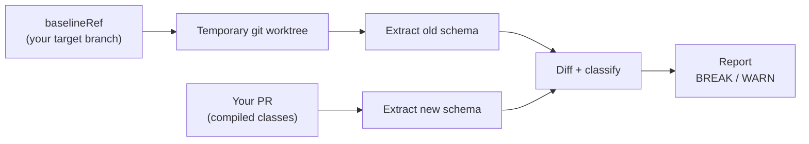
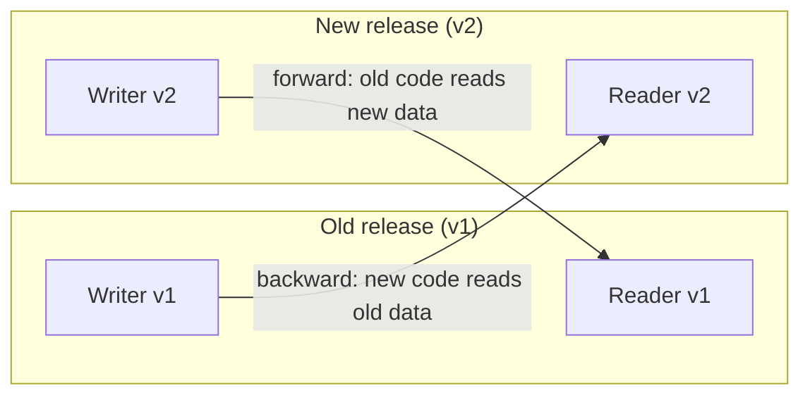

# Concepts

The ideas behind every serialkompat report: the baseline, backward versus forward
compatibility, `BREAK` versus `WARN`, and a glossary of the terms used across these docs.

## The baseline { #the-baseline }

The baseline is the schema you compare against. serialkompat doesn't read it from a
checked-in file. It rebuilds it on every run from a git ref:

Because the old schema comes from the real code on that ref, it can't go stale. The
flip side is that `baselineRef` must already contain the plugin; see
[Quick start → Your first PR](quickstart.md#first-time-adoption). If you don't set
`baselineRef`, serialkompat uses your repository's default branch. The mechanics are in
[Baseline & caching](baseline-caching.md).

## Backward vs forward { #backward-vs-forward }

Compatibility has two directions, and they fail differently. During a deploy, old and
new versions of your code run side by side, and each can read what the other wrote:

- **Backward** (new code reads old data): the new reader must decode payloads the old
  writer already produced, such as messages in a queue or rows in a database.
- **Forward** (old code reads new data): the old reader, still running during a rolling
  deploy or on a client that hasn't updated, must decode what the new writer produces.

Every finding says which direction broke, for example `(backward)`.

### Which direction do I pick? { #choosing-a-direction }

`direction` tells the classifier which reader/writer pairing must keep working after
the change. Pick it from how the schema is actually used:

| Direction | Guarantees | Use when |
|---|---|---|
| `BACKWARD` | New code can read data written by old code | Rolling deploys: a newer service version must decode messages/events produced by instances still running the old version |
| `FORWARD` | Old code can read data written by new code | Persisted data with slow migrations, or mixed-version consumers: an older reader (a replica, a cached job, a client that hasn't upgraded yet) must decode records a newer writer just produced |
| `FULL` | Both | Public APIs, shared wire formats, or persisted data with no controlled rollout order. The safest default when you don't control both ends |

`FULL` is the default. Keep it unless you know only one direction matters.

You need `FULL` for a queue whose producers and consumers deploy independently, or for
long-lived stored rows that code from any past version may read. A rolling deploy of a
single service, where old instances drain within minutes, only needs `BACKWARD` for that
window.

!!! warning
    `BACKWARD` and `FORWARD` each drop half the guarantee. Choose one deliberately,
    never as a way to silence findings.

The setting is `direction` in the [`serialkompat { }` block](configuration.md#serialkompat-reference),
or `--direction` on the [CLI](tasks-cli.md#cli).

## BREAK vs WARN { #break-vs-warn }

Every finding has a severity.

!!! failure "BREAK"
    Decoding fails: the reader throws, in the stated direction. A
    `BREAK` fails the build (unless you set `failOnBreaking` to `false`). You have four
    ways out: fix it, accept it, declare a rename, or bump the major version. See
    [Got a BREAK?](got-a-break.md).

!!! warning "WARN"
    The outcome depends on your configuration, or decoding succeeds but the data is
    silently wrong, defaulted or dropped. No exception is thrown. A `WARN` never fails the build. Read it, and decide whether your
    setup is affected. A type serialkompat couldn't analyse is also a `WARN`, because
    unanalysable never means safe; see [Limitations](limitations.md).

Breaks you have sanctioned with `acceptedBreaks` are called **accepted breaks** in these
docs, after the DSL name. The console report labels them "acknowledged" and SARIF labels
them "accepted"; they are the same thing, and they no longer fail the build.

The full list of rules, and which severity each gives under which configuration, is in
[Rules](rules.md).

## Glossary { #glossary }

| Term | Meaning |
|---|---|
| **Contract** | The wire shape serialkompat extracts for one serial name: its properties, optionality, defaults, nullability, enum values or sealed subtypes. Your model is a set of contracts |
| **Serial name** | The name a type goes by on the wire: `@SerialName` if present, otherwise the fully-qualified class name. A sealed or polymorphic subtype is reported as `Base/sub` |
| **Root type** | A `@Serializable` type you list in `types` (or that discovery finds). Everything reachable from a root, such as nested types and sealed subtypes, is checked too |
| **Baseline** | The old schema you compare against, extracted live from `baselineRef`. See [The baseline](#the-baseline) |
| **Snapshot** | The text file the extractor writes: every contract plus the `Json` or `Cbor` config. `serialkompatExtract` writes `build/serialkompat/current.snapshot`, and the CLI diffs two of them |
| **Finding** | One detected change: a severity, a rule id, the type it is about, a direction, and a suggested fix. A report is a list of findings |
| **OPAQUE / coverage gap** | A type serialkompat couldn't fully analyse is recorded as an `OPAQUE` contract and reported as a `COVERAGE_GAP` `WARN`, never a silent pass. See [Limitations](limitations.md) |
| **Pairwise vs history check** | A *pairwise* check compares your code against one baseline (`serialkompatCheck`). A *history* check compares it against every recorded release (`serialkompatCheckHistory`). See [Persisted data & history](history.md) |
| **Accepted break** | A break you sanctioned in `acceptedBreaks`. The console report calls it "acknowledged"; SARIF calls it "accepted" |
