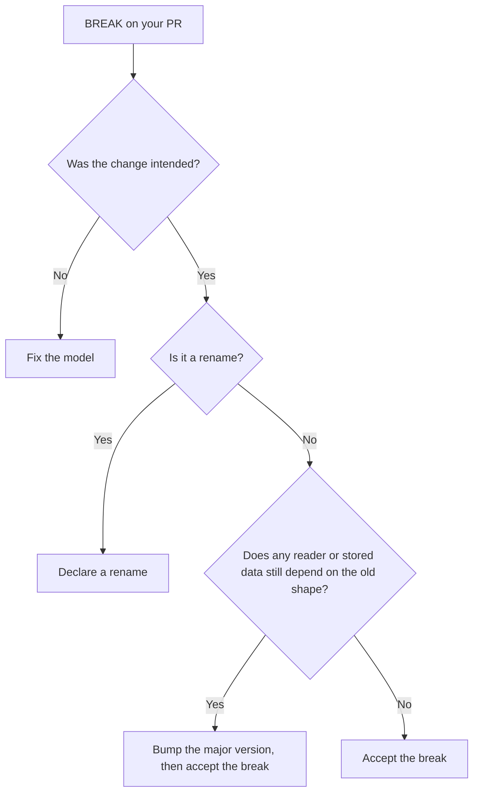

# Got a BREAK?

A decision path for a reported break: fix it, accept it, rename it, or bump the major
version. It is for the developer whose PR just failed. A `BREAK` means a reader throws in the
stated direction: [backward (new code reads old data)](concepts.md#backward-vs-forward) or
[forward (old code reads new data)](concepts.md#backward-vs-forward). Read the finding first:
it names the type, the rule, the direction and a `fix:` line.



<div class="grid cards" markdown>

- **[Fix it](#fix-it)**

    The change was an accident. Change the model, not the gate.

- **[Accept it](#accept-it)**

    Deliberate, and nothing still depends on the old shape.

- **[Declare a rename](#declare-a-rename)**

    A type or property moved. Say so, and it stops reading as remove plus add.

- **[Bump major](#bump-major)**

    Old data or old readers can't keep working.

</div>

## Fix it { #fix-it }

Most breaks are accidents, and the report's `fix:` line says what to do. The common fixes,
grouped by what changed. Every rule, in both directions, is in [the matrix](rules.md#the-matrix).

| What changed | Usual fix | Rules |
|---|---|---|
| **Fields** | | |
| A required field was added | Give it a default, or make it nullable with a default | [`PROPERTY_ADDED`](rules.md#property_added) |
| A field was removed | Keep it (deprecate it in code) until no reader or stored data uses it | [`PROPERTY_REMOVED`](rules.md#property_removed) |
| An optional field became required, or the reverse | Keep optionality, or annotate with `@EncodeDefault(ALWAYS)` (or set `encodeDefaults = true`) so the writer always emits it | `PROPERTY_OPTIONALITY` |
| A field's nullability changed | Keep it nullable, or introduce a new field | `PROPERTY_NULLABILITY` |
| A field's type changed | Introduce a new field instead of changing the type | `PROPERTY_TYPE_CHANGED` |
| **Enums** | | |
| A value was added | Enable `coerceInputValues` on the reader and give the reading field a default | [`ENUM_VALUE_ADDED`](rules.md#enum_value_added) |
| A value was removed | Keep the value (deprecated) until no persisted or old data uses it | `ENUM_VALUE_REMOVED` |
| **Polymorphism** | | |
| A subtype was added | Register a default deserializer on old readers, or bump major | `SUBTYPE_ADDED` |
| A subtype was removed | Keep it until no old or persisted data uses it | `SUBTYPE_REMOVED` |
| The discriminator key or value changed | Don't change it. It breaks all polymorphic decoding | `DISCRIMINATOR_CHANGED`, `DISCRIMINATOR_VALUE_CHANGED` |
| A property collides with the discriminator | Rename the property, or set a different `@JsonClassDiscriminator` | `DISCRIMINATOR_COLLISION` |
| **Types and config** | | |
| A whole type was removed | Keep it while data or peers still use it | `CONTRACT_REMOVED` |
| A `Json { }` setting changed | Revert it, or accept the change if every reader moves together | the `CONFIG_*` rules |
| **CBOR** | | |
| A `@CborLabel`, tag or `@CborArray` layout changed | See the rule section | [`PROPERTY_CBOR_LABEL`](rules.md#property_cbor_label), [`CBOR_ARRAY_LAYOUT`](rules.md#cbor_array_layout) |

For example, adding a field with a default keeps old payloads decodable:

```diff
 @Serializable
 data class Order(
     val id: String,
+    val currency: String = "USD",
 )
```

!!! success "After the fix"
    The finding disappears from the next run. Nothing was accepted, so the gate is as strict
    as before.

A `COVERAGE_GAP` is not a break to fix in the model. See [Limitations](limitations.md).

## Accept it { #accept-it }

If the break is deliberate, for example every consumer has stopped using a field, add the
finding to `acceptedBreaks`. It stops failing the build but still appears in the report, so
the break stays visible. Copy the type, rule and direction from the finding.

```kotlin title="build.gradle.kts"
serialkompat {
    acceptedBreaks.set(listOf(
        "com.example.wire.Payment PROPERTY_REMOVED BACKWARD",
    ))
}
```

### Sanctioning a deliberate break { #sanctioning-a-deliberate-break }

The format is `"<serialName> <RULE> [DIRECTION]"`:

- the type's serial name,
- the exact rule ID (see [Rules](rules.md)),
- an optional direction. Omit it to accept the finding in every direction you check, or give
  `BACKWARD` or `FORWARD` to accept it in only one.

An entry only covers findings with that serial name and rule. Every other finding on the
type, or under that rule elsewhere, still fails. A sealed or polymorphic subtype is reported
as `Base/sub`. Write `Base/sub` to accept the break under that base only, or the bare `sub`
to accept it under every base.

These are **accepted breaks** in these docs. The console report calls them "acknowledged"
and keeps them in a separate count, so an accepted break stays visible.

!!! failure "Don't accept to silence an unintended break"
    An accepted break is a promise that nobody still depends on the old shape. If you
    can't say who stopped using it, [fix it](#fix-it) or [bump the major
    version](#bump-major) instead. Remove the entry once the break has shipped, so the same
    rule isn't silently accepted again next time.

## Declare a rename { #declare-a-rename }

A rename reads as a removal plus an addition unless you declare it.

- **A type's serial name changed:** declare it in `renames`. serialkompat then compares the
  two types' contents instead of reporting `CONTRACT_REMOVED`.

    ```kotlin title="build.gradle.kts"
    serialkompat {
        renames.put("com.example.wire.LegacyOrder", "com.example.wire.OrderEvent")
    }
    ```

- **A property was renamed (JSON):** keep the old name readable with `@JsonNames`, so new code
  still decodes old payloads.

    ```kotlin
    @Serializable
    data class Order(
        @JsonNames("note") val memo: String? = null,
    )
    ```

  CBOR has no such bridge: `@JsonNames` is ignored, and a renamed field is a remove plus an
  add. See [CBOR](cbor.md).

## Bump major { #bump-major }

If old data or old readers really can't keep working, ship the break as a new major version.
Accept the break (above) in the same PR, and note it in your changelog. Once that PR is
merged into `baselineRef`, later changes are compared against the new shape. If you keep
[history](history.md), consider whether the horizon should now start at the new major
(`sinceVersion`).
