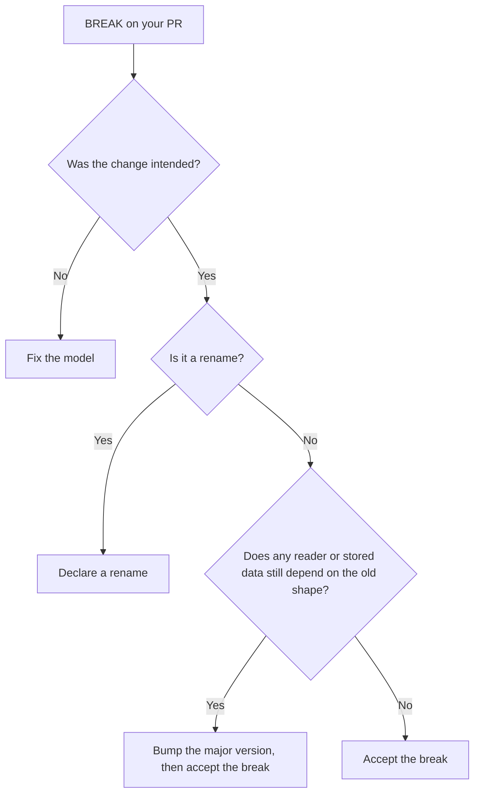

# Got a BREAK?

A decision path for a reported break: fix it, accept it, rename it, or bump the major
version. It is for the developer whose PR just failed. A `BREAK` means a reader throws in the
stated direction: [backward (new code reads old data)](concepts.md#backward-vs-forward) or
[forward (old code reads new data)](concepts.md#backward-vs-forward).



## Fix it { #fix-it }

Most breaks are accidents, and the report's `fix:` line says what to do. The common fixes
per rule family:

| Change | Usual fix | Rule |
|---|---|---|
| Added a required field | Give it a default, or make it nullable with a default | [`PROPERTY_ADDED`](rules.md#property_added) |
| Removed a field | Keep it (deprecate it in code) until nothing reads it | [`PROPERTY_REMOVED`](rules.md#property_removed) |
| Added an enum value | Enable `coerceInputValues` and give the reading field a default | [`ENUM_VALUE_ADDED`](rules.md#enum_value_added) |
| Anything else | Look the rule up in the matrix | [Rules](rules.md#the-matrix) |

For example, adding a field with a default keeps old payloads decodable:

```diff
 @Serializable
 data class Order(
     val id: String,
+    val currency: String = "USD",
 )
```

## Accept it { #accept-it }

If the break is deliberate, for example every consumer has stopped using a field, add the
finding to `acceptedBreaks`. It stops failing the build but still appears in the report, so
the break stays visible.

```kotlin title="build.gradle.kts"
serialkompat {
    acceptedBreaks.set(listOf(
        "com.example.wire.Payment PROPERTY_REMOVED BACKWARD",
    ))
}
```

### Sanctioning a deliberate break { #sanctioning-a-deliberate-break }

The format is `"<serialName> <RULE> [DIRECTION]"`:

- the type's serial name,
- the exact rule ID (see [Rules](rules.md)),
- an optional direction. Omit it to accept the finding in every direction you check, or give
  `BACKWARD` or `FORWARD` to accept it in only one.

An entry only covers findings with that serial name and rule. Every other finding on the
type, or under that rule elsewhere, still fails. A sealed or polymorphic subtype is reported
as `Base/sub`. Write `Base/sub` to accept the break under that base only, or the bare `sub`
to accept it under every base.

These are **accepted breaks** in these docs. The console report calls them "acknowledged"
and keeps them in a separate count, so an accepted break stays visible.

## Rename it { #rename-it }

A rename reads as a removal plus an addition unless you declare it.

- **A type's serial name changed:** declare it in `renames`. serialkompat then compares the
  two types' contents instead of reporting `CONTRACT_REMOVED`.

    ```kotlin title="build.gradle.kts"
    serialkompat {
        renames.put("com.example.wire.LegacyOrder", "com.example.wire.OrderEvent")
    }
    ```

- **A property was renamed (JSON):** keep the old name readable with `@JsonNames`, so new code
  still decodes old payloads.

    ```kotlin
    @Serializable
    data class Order(
        @JsonNames("note") val memo: String? = null,
    )
    ```

  CBOR has no such bridge: `@JsonNames` is ignored, and a renamed field is a remove plus an
  add. See [CBOR](cbor.md).

## Bump the major version { #bump-the-major-version }

If old data or old readers really can't keep working, ship the break as a new major version.
Accept the break (above) in the same PR, and note it in your changelog. Once that PR is
merged into `baselineRef`, later changes are compared against the new shape. If you keep
[history](history.md), consider whether the horizon should now start at the new major
(`sinceVersion`).
