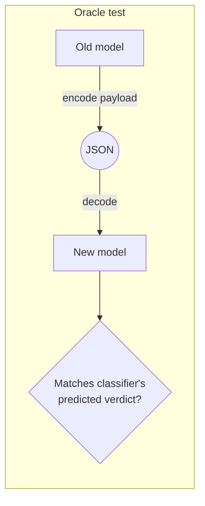

# The oracle

Why serialkompat's verdicts can be trusted: every classification rule is checked against
the real kotlinx-serialization library, not derived from its spec. This page is for anyone
deciding whether to rely on a verdict, and for contributors adding a rule.

## How a rule is proven { #how-a-rule-is-proven }

The differ lists the structural changes between two snapshots, and the classifier scores
each one per direction: [backward (new code reads old data)](concepts.md#backward-vs-forward)
and [forward (old code reads new data)](concepts.md#backward-vs-forward). Scoring uses the real
`Json { }` or `Cbor { }` config in play, so the same change can be `SAFE` under one reader
config and `BREAK` under another ([Config awareness](rules.md#config-awareness)).

None of that comes from reading kotlinx-serialization's source or spec. Every rule is
backed by a round-trip oracle test. The test serializes a payload with the old model and
decodes it with the new one (and the reverse), using the real library under the declared
config. It then checks that the classifier predicted what actually happened.

The checks are one-sided where that's the safe side to err on:

- **A real failure must be predicted.** If the real decode throws, the classifier must
  have reported a `BREAK` in that direction. Flagging a change that turns out to decode is
  allowed; missing one that throws is not.
- **Silent data loss must be flagged, where it's tested for.** The config-only oracle
  (same model, different reader and writer config) and a set of targeted tests also
  decode a payload that succeeds but yields a different value than was written, for
  example a field silently dropped under `ignoreUnknownKeys`. There, the classifier must
  report at least a `WARN`, never `SAFE`. The plain schema-change check doesn't compare
  values, only whether the decode threw.
- **Some relaxations are tested both ways.** Where a config turns a `BREAK` into
  something milder, such as `explicitNulls = false` letting an absent nullable field
  decode as `null`, the oracle also checks that the real decode succeeds and that the
  classifier doesn't report a `BREAK`.

A rule without an oracle test doesn't ship. That's what turns "the classifier predicts
`SAFE`" into a verified claim about real decode behavior, rather than an assumption about
the spec.

## Finding a rule's proof { #finding-a-rules-proof }

Each rule entry in [Rules](rules.md#rule-reference) ends with a **Proof** line linking the
oracle tests behind it. For example, [`PROPERTY_REMOVED`](rules.md#property_removed) cites
`removing an optional field` (JSON) and its CBOR counterpart. The JSON tests live in
[`RoundTripOracleTest.kt`](https://github.com/chrisjenx/serialkompat/blob/main/serialkompat-extractor/src/test/kotlin/com/chrisjenx/serialkompat/extractor/RoundTripOracleTest.kt)
and the CBOR ones in
[`CborRoundTripOracleTest.kt`](https://github.com/chrisjenx/serialkompat/blob/main/serialkompat-extractor/src/test/kotlin/com/chrisjenx/serialkompat/extractor/CborRoundTripOracleTest.kt).

Two build gates keep the rules page honest: one fails if a shipped rule is missing from
it, the other if a Proof link cites a test that doesn't exist. See
[Contributing → Docs site](contributing.md#docs-site).

## Where the oracle stops { #where-the-oracle-stops }

The oracle can only test types the extractor can see. When it can't fully analyse a type,
it records it as `OPAQUE` and the classifier reports a `COVERAGE_GAP` `WARN`. It never
guesses `SAFE`: unanalysable is never treated as compatible.
[Limitations](limitations.md#when-a-type-cant-be-analysed) lists what makes a type opaque
and what to do about it.
